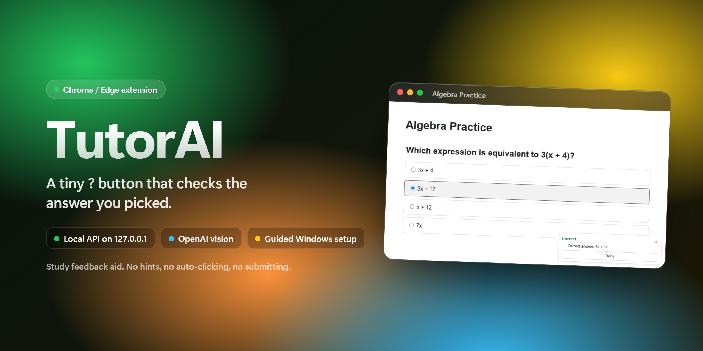
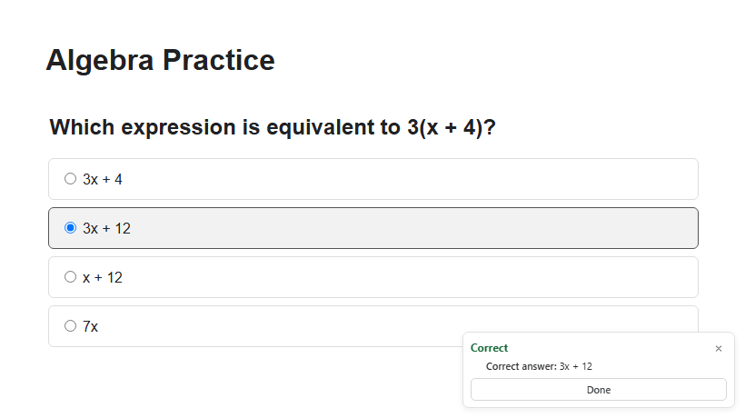
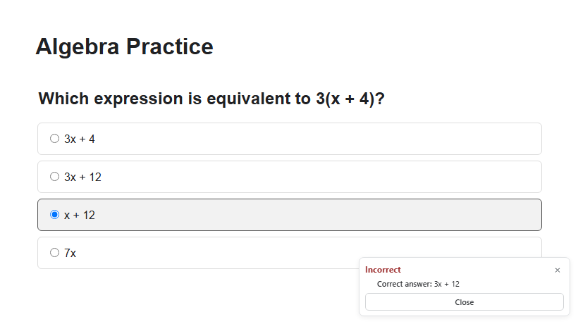
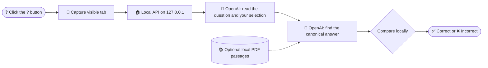

<p align="center">
  
  
  
  <a href="https://github.com/whynobro/tutorai/commits/main"></a>
</p>

<h3 align="center">A compact Chrome/Edge answer checker with a local OpenAI API service.<br>Pick an answer, click the tiny <code>?</code>, get Correct or Incorrect.</h3>

<p align="center">
  <a href="https://github.com/whynobro/tutorai/archive/refs/heads/main.zip"><b>⬇ Download ZIP</b></a>
  &nbsp;·&nbsp; <a href="#-getting-started">Getting started</a>
  &nbsp;·&nbsp; <a href="#-configuration">Configuration</a>
  &nbsp;·&nbsp; <a href="#-privacy-and-appropriate-use">Privacy</a>
  &nbsp;·&nbsp; <a href="#-developer-commands">Developers</a>
</p>

TutorAI is a small local Chrome/Edge extension. A learner selects an answer on a visible multiple-choice page, clicks the tiny `?` in the lower-right corner, and receives **Correct** or **Incorrect** plus the canonical answer identified by the checker.

It does not provide hints, click answers, or submit work.

## ✨ Features

| | |
|---|---|
| ❓ **One tiny button** | A 28 px `?` in the lower-right corner of ordinary `http://` and `https://` pages. Nothing is captured until you click it. |
| ✅ **Clear verdict** | Shows **Correct** or **Incorrect** plus the canonical answer, or a short failure message such as "Select an answer first". |
| 🚫 **No shortcuts** | No hints, no clicking answers for you, no submitting work. |
| 🏠 **Local API service** | A Fastify service on `127.0.0.1:8787` owns your OpenAI key. The extension bundle never contains it. |
| 📚 **Optional course references** | Point `COURSE_REFERENCE_DIR` at a folder of PDFs. Text is extracted locally and only a few relevant passages are sent with each check. |
| 🪟 **Guided Windows setup** | Double-click `setup-windows.cmd` to install, build, and create your `.env`, then `start-tutorai.cmd` to run the service. |
| 🎛️ **Style-safe UI** | The widget lives in a Shadow DOM, so page styles do not leak in. Press Escape to close it. |

<p align="center">
  
  
</p>
<p align="center"><sub>The real extension UI on the repo's sample fixture page (<code>tests/fixtures/assignment.html</code>), with a stubbed service response.</sub></p>

## 🧭 How it works



Both OpenAI steps use the Responses API with `store: false`. The final correct/incorrect comparison is made by the local API, and low-confidence or unreadable cases come back as a safe failure message instead of a guess.

## 🚀 Getting started

The complete beginner-friendly guide is the **[Windows Setup Guide](docs/WINDOWS_SETUP.md)**. The short version:

1. Install the current [Node.js LTS release](https://nodejs.org/en/download) (22.13.0 or newer).
2. Download this repository from [GitHub](https://github.com/whynobro/tutorai) ([direct ZIP](https://github.com/whynobro/tutorai/archive/refs/heads/main.zip)) and extract it.
3. Double-click `setup-windows.cmd`. It checks Node.js, runs `npm ci`, creates `.env` from `.env.example`, type-checks, and builds the API and extension.
4. Put your own OpenAI API key in the generated `.env` file.
5. Optionally set `COURSE_REFERENCE_DIR` in `.env` to a local folder containing course PDFs.
6. Double-click `start-tutorai.cmd` and leave its window open. You can check `http://127.0.0.1:8787/health`.
7. Open `chrome://extensions` or `edge://extensions`, enable **Developer mode**, select **Load unpacked**, and choose `apps\extension\dist`.

### What the recipient needs

- Windows 10 or 11
- Chrome or Microsoft Edge
- Node.js 22.13.0 or newer (an LTS release is recommended)
- An OpenAI Platform account, API key, and available API billing/credits
- Permission to use screenshots and outside assistance on the pages where TutorAI is used

A ChatGPT subscription and OpenAI API billing are separate. Each recipient should create and pay for their own API key. Never send an API key by email, text message, Discord, or GitHub.

## ⚙️ Configuration

Settings live in the `.env` file at the repo root (copy `.env.example`). Variable names only here:

| Variable | Purpose | Default |
|---|---|---|
| `OPENAI_API_KEY` | Your own OpenAI API key. Required. | placeholder in `.env.example` |
| `OPENAI_MODEL` | Model used for the checks. Any compatible model works. | `gpt-5.4-mini` (medium reasoning effort for answer solving) |
| `PORT` | Port the local API listens on (the host is always `127.0.0.1`). | `8787` |
| `CHECK_CONFIDENCE_THRESHOLD` | Minimum confidence before a verdict is shown. | `0.8` |
| `COURSE_REFERENCE_DIR` | Optional folder of course PDFs for local retrieval. Restart after changing it or its PDFs. | empty |

## 🔒 Privacy and appropriate use

- The OpenAI API key stays in the local `.env` file and local API process.
- `.env`, build output, and dependencies are excluded from Git.
- A screenshot is taken only after the user clicks `?`. The widget hides itself first, and no screenshot is taken while idle.
- The application does not write screenshots to disk.
- Screenshots go to the OpenAI Responses API with `store: false`. OpenAI's own data controls still apply.
- Only retrieved course PDF passages, not whole files, are sent with a check request.
- The extension receives the binary result, canonical answer, or a safe failure category.
- The extension asks for the `tabs` and `scripting` permissions plus `<all_urls>` host access, which Chrome and Edge require to capture the visible tab.

Use TutorAI only where outside tools and screenshots are permitted, and follow your school or organization's rules. It is not guaranteed to be correct and should not be used for high-stakes decisions. See [Privacy and Safety](docs/PRIVACY_AND_SAFETY.md) for the full explanation.

## 🛠️ Developer commands

```powershell
npm ci
Copy-Item .env.example .env
npm run typecheck
npm test
npm run build
npm run start:api
```

The API listens only on `127.0.0.1:8787`. Its health endpoint is `http://127.0.0.1:8787/health`. When `COURSE_REFERENCE_DIR` is set, the API extracts PDF text locally at startup and retrieves a few relevant passages for each question.

## 🧱 Tech stack

- **Extension:** Manifest V3, React 19, Shadow DOM, bundled with esbuild
- **API:** Node.js 22.13+, Fastify 5 with CORS and rate limiting, the OpenAI SDK, `pdfjs-dist` for local PDF text
- **Shared:** strict request/response schemas with Zod in `packages/contracts`
- **Tooling:** TypeScript, Vitest, npm workspaces

## 🗂️ Project layout

- `apps/extension`: Manifest V3 browser extension and compact UI
- `apps/api`: local API process that owns the OpenAI key
- `packages/contracts`: strict request/response schemas
- `tests/fixtures`: a sample multiple-choice page
- `scripts`: Windows setup and launch helpers
- `docs`: setup, troubleshooting, privacy, handoff checklist, and roadmap

## 📚 Documentation

- [Full Windows setup](docs/WINDOWS_SETUP.md)
- [Troubleshooting](docs/TROUBLESHOOTING_WINDOWS.md)
- [Privacy, permissions, and appropriate use](docs/PRIVACY_AND_SAFETY.md)
- [Sender handoff checklist](docs/HANDOFF_CHECKLIST.md)
- [Improvement roadmap](docs/IMPROVEMENTS.md) for known limitations and practical next steps

## 📄 License

No license file is included in this repository yet.
